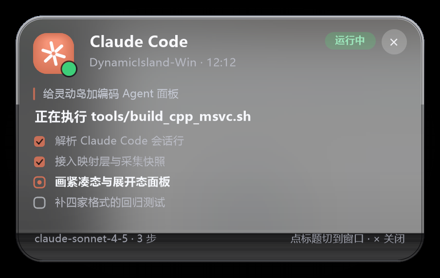
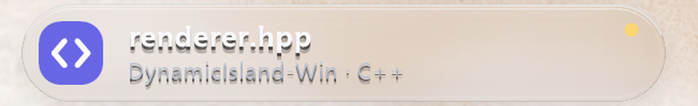
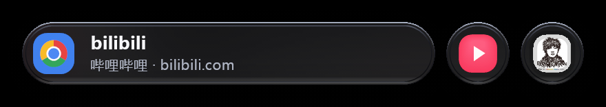
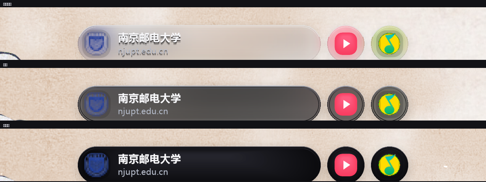
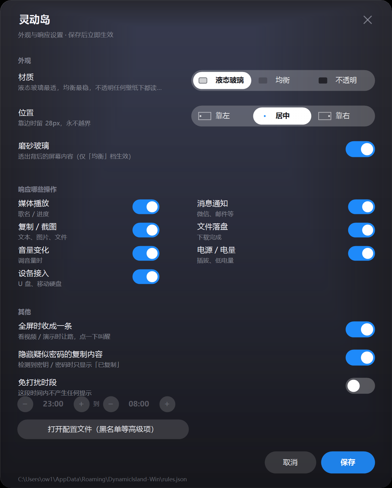

<div align="center">

# DynamicIsland-Win

[](https://github.com/Current-off/DynamicIsland-Win/actions/workflows/ci.yml)
[](LICENSE)
[](#三十秒装好)

**Windows 也有灵动岛。** 屏幕顶部一颗胶囊，把「正在发生的事」收进来 ——
正在播的歌、正在跑的任务、正在改的文件、正在开的会。


</div>

---

## 三十秒装好

**A. 直接用**（不需要编译环境）

下载 [Releases](../../releases) 里的 `DynamicIsland-Win-*.zip` → 解压 → 双击 `install.cmd`。
装到 `%LOCALAPPDATA%\DynamicIsland-Win`，并设置开机自启。

> **首次运行会被 Windows 拦一下，这是正常的。** 本程序没有代码签名证书，会弹
> 「Windows 已保护你的电脑 / 发布者：未知发布者」。点【更多信息】→【仍要运行】，
> 只会问这一次。不放心的话，用下面的 B 自己编译。
>
> 卸载：双击 `uninstall.cmd`（配置默认保留）。

**B. 从源码构建**（需要 Windows 10 1809+ 与 VS2022，勾选「使用 C++ 的桌面开发」）

```powershell
git clone <this-repo> && cd DynamicIsland-Win

# 编译 + 跑测试（559 项断言，约 40 秒）
powershell -ExecutionPolicy Bypass -File tools\build.ps1

# 装到 %LOCALAPPDATA% 并启动
powershell -ExecutionPolicy Bypass -File tools\install.ps1
```

想开机自启给 `-Autostart`；不想用了 `-Uninstall`（配置默认保留，重装还在）。
想打成可分发 zip：`tools\package.ps1`，产物在 `build\dist\`。

> 不需要管理员权限，不注入系统进程，不装驱动，不写 Program Files。
> 构建脚本从 `vswhere` 和注册表推导工具链路径 —— 你的 VS/SDK 装在 D 盘也能编。

## 别的程序也能往上推

不用弹自己的通知：任何程序都能往命名管道写一行 JSON，让事件上岛。

```powershell
tools\send-activity.ps1 -Title "构建通过" -Kind "bridge.ci" -Content '{"body":"528/528"}'
```

协议见 [docs/protocol.md](docs/protocol.md)（一次连接一条消息，UTF-8 JSON lines，
服务端回一行确认）。其他语言连 `\\.\pipe\DynamicIslandWin-v1` 写一行即可。

## 它显示什么

| | 显示 | 数据从哪来 |
|---|---|---|
|  | **编码 Agent**：Claude Code / Codex / Gemini / WorkBuddy / Pi / ZCode / Cursor。小岛是「项目 + 此刻在做什么 + 进度」，大岛是任务清单与动作时间线 | 各家自己落盘的会话文件，增量 tail |
|  | **正在改的文件**：文件名 + 项目 + 语言 + 未保存标记 | 前台窗口标题 |
|  | **浏览器**：站点真实图标 + 标签页标题 + 域名，有下载时右侧显示进度（Chrome / Edge / Firefox / 360 / QQ / 夸克… 20 家） | 窗口标题 + History / Favicons / downloads（只读 SQLite） |
|  | **会议**：腾讯会议 / Zoom / Teams / 钉钉 / 飞书 / Discord，显示会议名与已开时长 | 谁在占用麦克风（WASAPI） |
| | **媒体**：歌名 / 歌手 / 封面 / 可拖动进度 / 在线歌词（三行滚动） | SMTC，与所有主流播放器共用 |
| | **通知**：标题 / 正文 / 来源应用图标，6 秒退场 | `UserNotificationListener` |
| | **复制 / 截图 / 文件落盘 / 电源 / 音量 / U 盘** | Win32 / CoreAudio / 剪贴板序列号 |

多件事同时发生时，紧凑态是「**一个主胶囊 + 最多两个小圆**」—— 点哪个小圆就展开哪一件。
双击铺开一览，所有并行任务各自成岛。超过三件显示 `+N`。


## 三种材质

设置里点一下就能换，每档带着效果预览：



- **液态玻璃**（默认）—— 薄、透，能看出背后是什么；靠边缘折射亮环与顶部镜面线界定形状
- **均衡** —— 深色磨砂，可读性最稳
- **不透明** —— 实心深色，任何壁纸下都能读

位置也有三档：靠左 / 居中 / 靠右，按**工作区**计算，任何情况下都不越界。



## 交互

| 操作 | 结果 |
|---|---|
| 左键点胶囊 | 展开 / 收起 |
| 双击 | 铺开一览（所有并行任务） |
| 点小圆 | 展开它代表的那一件 |
| 右键胶囊 / **点托盘图标** | 同一个菜单：设置 / 展开全部 / 暂停 30 分钟 / 退出 |
| 拖进度条 | seek |
| **媒体展开态底部五个钮** | 上一首 · −10 秒 · 播放暂停 · +10 秒 · 下一首 |
| 点标题 | 切回对应的应用 / 编辑器 / 浏览器 / 终端 |
| 全屏、或久未交互 | 收成顶部一条极淡的把手，点一下叫醒 |
| **没有任何活动时** | 收成一枚与休眠条同高的小圆，缓慢呼吸 —— 它只回答「还在不在跑」，点它出菜单 |

托盘图标就是这个程序的「门」：胶囊可能正处在休眠（只剩一条细把手）甚至完全不显示
的状态，没有托盘时会找不到退出和设置的入口。Explorer 重启后图标会自动重挂。

## 隐私

- 不联网（在线歌词除外，可关），不开调试端口，不上传任何东西
- 不注入、不挂钩子、不读内存；只读「系统公开给你的」和「各应用自己落盘的文件」
- 浏览器只读 `History` / `Favicons` / `downloads` 三个库；关掉 `browsers` 后连这些库都不打开
- Agent 只读会话文件，不把对话正文上屏

## 当前状态

C++20，MSVC `/W4` 零警告。**510 项断言**在每次构建时全部跑一遍：
核心域 89 / 规则 155 / 渲染 25 / 交互 45 / Agent 119 / 编辑器 59 / 浏览器 28 / 繁简 6 / 缓存 8，
另有 7 项跨语言契约校验。

还没做的：帧率与内存基线未测量；材质是自绘模拟而非 DWM 亚克力；
拼音/输入法类长尾适配未覆盖。取舍与验证过程见 [`docs/`](docs/)。

## 它现在读的是你的真实系统，不是剧本

默认就是**真实模式**：你在网易云 / QQ 音乐 / B 站 / 浏览器里按下播放，胶囊上出现的就是你正在听的那首歌；系统弹出通知，胶囊会短暂显示那条通知然后自动退场。

| 数据源 | 接入方式 | 表现 |
|--------|----------|------|
| 媒体播放 | SMTC（`GlobalSystemMediaTransportControlsSessionManager`） | 歌名 / 歌手 / 专辑 / 实时进度条 / **真实专辑封面**。与所有主流播放器共用同一通道 |
| 系统通知 | `UserNotificationListener`（未打包实测 Allowed） | 标题 / 正文 / **来源应用图标**；新通知出现 6 秒后退场，启动时**不**刷历史通知。采样：常态 2s，捕获到新通知后 10 秒内切 500ms |
| 复制 / 截图 | `GetClipboardSequenceNumber` + `CF_UNICODETEXT` / `CF_DIB` / `CF_HDROP` | 区分「已复制」「已复制图片」「已截图」「已复制 N 个文件」，并标出**来源应用**；3.2 秒退场 |
| 文件落盘 | 监控「下载」目录最新 mtime | 显示文件名 + 扩展名，8 秒退场 |
| 电源 | `GetSystemPowerStatus` | 插拔电源即时提示（4 秒）；低于 20% 且未充电时常驻提示 |
| 浏览器 | 前台窗口标题 + 各家 History / Favicons / downloads（SQLite，只读） | 小岛显示「站点图标 + 当前标签页 + 域名」，大岛显示完整 URL 与下载进度；**不联网、不开调试端口** |
| 编码 Agent | 增量 tail 各家会话文件（`.claude` / `.workbuddy` / `.codex` / `.gemini`） | 小岛显示「项目 + 此刻的动作 + 进度」，大岛显示任务清单 / 动作时间线；**不调任何 API、不需要 token** |
| 音量 | Core Audio `IAudioEndpointVolume` | 音量变化或静音切换后 2.5 秒短提示 |
| 设备接入 | `WM_DEVICECHANGE` + `DEV_BROADCAST_VOLUME` | 插入 U 盘 / 移动硬盘显示盘符，4.5 秒退场 |
| 全屏 | `SHQueryUserNotificationState` | 全屏 / 演示模式自动避让并暂停采样 |

**优先级（越高越先占主位）**：通知 75 > **Agent 运行中 74** > 低电量 70 > 复制/截图 68
> **浏览器（在下东西）66** > 文件 65 > **浏览器（前台）64** > 设备 62 > 媒体 60
> 电源插拔 58 > **Agent 等待输入 50** > 音量 30。

> 浏览器压在媒体之上是有意的：用户盯着一个页面时，后台那张专辑在放什么是背景信息；
> 反过来把音乐放主位、把「我在看什么」塞进小圆，才是错位。浏览器自己放视频时
> 它不会出这条岛（媒体那条已经讲了同一件事），所以两者不会冲突。
理由：前四个都是「刚发生、有信息量、值得看一眼」；音乐是「你自己在放」，适合当常驻底噪。

## 编码 Agent 也上岛

你同时开着 Claude Code、Codex、Gemini CLI，它们各自在改哪个仓库、改到第几步、是不是在等你确认 —— 这些现在能在岛上看到，**不需要给它们装插件，也不需要任何 API key**。

| 形态 | 显示什么 |
|------|----------|
| 小岛（紧凑） | 品牌图形 + 项目名 + **此刻在做什么**（`正在编辑 win32/renderer.hpp`）+ 右侧进度（`3/7` 或 `78 步`）+ 心跳点。运行中绿点呼吸，等待输入转为琥珀 |
| 大岛（展开） | 品牌 + 项目 · 已运行时长 → 会话任务 → 当前动作 → **任务清单**（有 `TodoWrite` / `update_plan` 时）或**最近 4 步动作时间线**（没有清单时）→ 页脚显示模型与步数 |
| 一览 | 每个 Agent 一个岛，各自的品牌色与状态点；点开直接进详情 |

支持矩阵（路径都是各家自己的落盘目录，程序只读不写）：

| Agent | 数据源 | 形态 |
|-------|--------|------|
| Claude Code | `%USERPROFILE%\.claude\projects\<项目>\<会话>.jsonl` | JSONL |
| WorkBuddy / CodeBuddy | `%USERPROFILE%\.workbuddy\projects\<项目>\<会话>.jsonl` | JSONL |
| OpenAI Codex CLI | `%USERPROFILE%\.codex\sessions\YYYY\MM\DD\rollout-*.jsonl` | JSONL |
| Gemini CLI | `%USERPROFILE%\.gemini\tmp\<项目>\chats\session-*.json` | 整文件 JSON |
| **Pi** | `%USERPROFILE%\.pi\agent\sessions\--<cwd>--\<ts>_<uuid>.jsonl` | JSONL |
| **ZCode**（GLM / DeepSeek 的编码 CLI） | `%USERPROFILE%\.zcode\cli\db\db.sqlite` | SQLite |
| **Cursor** | `%APPDATA%\Cursor\User\globalStorage\state.vscdb` | SQLite |

### 明确不支持的（原因写在这里，省得你反复试）

| Agent | 为什么读不到 |
|-------|-------------|
| **Trae / Trae CN** | 会话库 `%APPDATA%\Trae\ModularData\ai-agent\database.db` 是**加密/私有格式**（magic `2a 76 9b a7`，连 SQLite 头都不是），不是我们的解析问题 |
| **ZCode 桌面版 / Z.ai 客户端** | 对话正文在云端，本地 `Local Storage` 里只有草稿、模型选择、窗口布局这些元数据 |
| **DeepSeek Harness Desktop**（`@deepseek-ai/dsh-desktop`） | 同上：`dsh.conversation.session-*` 这类 key 只有 `{"sessionId":…}`，正文不落本地 |
| **Cursor 的历史会话** | 支持，但只显示最近 6 小时内动过的 composer；更早的留在库里不打扰 |

> 判断「某个 agent 到底有没有数据」：`build/cpp/agent_probe.exe --all`。
> 它会忽略时间窗，把这四类（JSONL / SQLite / 目录不存在 / 打开失败）分别列出来 ——
> 「没有数据」和「有数据但没解析出来」是两件完全不同的事，先分清再动手。

**怎么做到的**：这些工具都会把每一步落盘（工具调用、模型回复、任务清单），只是形态分两种 —— 七家里五家写 JSONL，Cursor 和 ZCode 写 SQLite。`src/core/agent_session.hpp` 把它们归一化成同一套事件；`src/win32/agent_sources.hpp` 对 JSONL 只读**新增的那一段**（首轮读头部 64KB 拿任务、尾部 1MB 拿当前状态），对 SQLite 走 `src/win32/sqlite_lite.hpp`（动态绑定系统自带的 `winsqlite3.dll`，只读打开，不引入任何第三方库）。频率：JSONL 800ms、SQLite 3s。

**状态怎么判**：最近 45 秒内还有新内容落盘 = 运行中；安静但没超过 `agent_idle_sec`（默认 8 分钟）= 等待输入；再久就撤岛。45 秒而不是几秒，是因为模型推理时**根本不写文件**，窗口太短会让岛在它正忙的时候说「在等你」。

点岛标题 = 把承载它的那个终端 / 编辑器窗口提到前台（按窗口标题匹配项目名，失败则打开项目目录）。

**隐私**：只读、不写、不联网；关掉 `agents` 后连这些目录都不扫。会话文件里有什么，它就只显示「项目 / 动作 / 清单」，不把对话正文上屏。

## 设置面板

设置不是系统灰底对话框 —— 它和胶囊共用同一套字体、圆角、渐变和强调色，
因为「设置长得像另一个软件」本身就是一种割裂。

| 项 | 说明 |
|----|------|
| **材质** | 三档，每档在选项里就画着效果：`液态玻璃` 薄、透、有边缘折射（默认）、`均衡` 深色磨砂、`不透明` 深色实心 |
| **位置** | 三档：`靠左` / `居中` / `靠右`，各带一个「屏幕 + 圆点」示意图；靠边留 28px，且**任何情况下都不越界**（岛比屏幕宽时贴左边） |
| 磨砂玻璃 | 只在「均衡」档有意义 |
| 响应哪些操作 | 7 类事件，两列排布，整行可点 |
| 其他 | 全屏收成一条、隐藏疑似密码的复制内容、免打扰时段（−/+ 每档 15 分钟） |

Esc 取消、Enter 保存、点右上 × 取消、拖标题区移动窗口。保存后运行中的实例 1 秒内热加载。

**黑名单去哪了**：原来那两个多行文本框不进自绘面板了 —— 深色面板里塞原生 EDIT 会立刻露馅
（滚动条、光标、选中色全是系统的）。黑名单移到「打开配置文件」，它本来就是低频操作，
配置文件也才是权威来源。

### 三档材质的做法

| 档 | 怎么画 | 适合 |
|----|--------|------|
| 液态玻璃 | 13% 中性冷调染色 + **轻模糊保色**的背景纹理 + 边缘折射亮环 + 顶部镜面线 + 左上反光 | 默认。透，但看得出是一层玻璃 |
| 均衡 | 70% 深色染色 + 3 趟重模糊 + 35% 去饱和 | 深色壁纸、要最高可读性 |
| 不透明 | 实心深色 + 径向受光 | 任何壁纸下的底线 |

液态玻璃的关键不是"把染色调淡"，而是**换一份背景纹理**。均衡档为了不让背后的彩色窗口抢内容，
做了重模糊 + 35% 去饱和 —— 浅米色壁纸进去，出来是一片均匀的灰，再怎么调染色都是"灰塑料"。
所以 backdrop 现在出两份：一份重模糊去饱和（均衡用），一份轻模糊**保留色彩甚至提饱和 20%**（液态玻璃用）。
玻璃会聚光，透过去的颜色本来就比背景更浓。

另一个坑是所有高光必须是**中性白**。加一点蓝，暖色壁纸就会被整体拉冷成灰 —— 这一条调试了很久。

## 会议也上岛

判断「你是不是在开会」不看窗口标题 —— Zoom 和腾讯会议开着客户端和正在会中，
标题几乎一样，靠标题猜必然一半误报。

真正的判据是**麦克风占用**：枚举默认麦克风上正在 `Active` 采音的音频会话，
看是哪个进程在用。所以：

- 只知道「谁在用麦克风」，不碰任何音频内容，不联网；
- 会议软件开着但已离会 → 没有活动会话 → 不出岛（这正是不该报的情况）；
- 切共享屏幕导致会话短暂中断时有 25 秒宽限，不会让岛在会中反复闪烁。

小岛显示：话筒图标（录音红）+ 会议名 + `正在开会 · 12:34` + 右侧呼吸红点。
点标题把它切回前台。支持腾讯会议 / VooV / Zoom / Teams / 钉钉 / 飞书 / WeLink / Discord。

## 浏览器也上岛

浏览器是最常开、却最容易被做成「一个没有信息量的方块」的东西。这里的目标是让岛
**一眼回答「我在哪个站、看的什么、还在下什么」**：

| 形态 | 显示什么 |
|------|----------|
| 小岛（紧凑） | **站点真实图标**（从浏览器自己的图标库里抠的）+ 当前标签页标题 + `站名 · 域名`；有下载时右侧一列「62% + 进度条」 |
| 大岛（展开） | 完整标题 → 完整 URL → 下载列表（文件名 + 进度 + 百分比）→ 页脚 `Microsoft Edge · 点标题切回浏览器` |
| 一览 | 每个浏览器一个岛，带自己的站点图标 |

点标题 = 把那个浏览器窗口拉回前台（不是再开一个）。

支持的浏览器（按进程名 + 窗口标题后缀识别，20 家）：

| 系 | 浏览器 |
|----|--------|
| Chromium | Chrome、Edge、Brave、Vivaldi、Chromium、Opera / Opera GX、Yandex、Arc |
| Gecko | Firefox、Waterfox、LibreWolf |
| 国产壳 | 360 安全 / 极速、QQ 浏览器、搜狗高速、2345、UC、夸克 |

**数据从哪来**（三条腿，任何一条断了都能降级）：

1. **前台窗口标题** —— 所有浏览器都有，而且是「当前标签页」唯一正确的来源。剥掉 ` - Google Chrome` 这类后缀就得到页面标题。
2. **History 库反查域名** —— 标题里没有域名，而域名才回答「这是哪个站」。按标题精确匹配，匹配不上就在最近 24 条里找「互相包含」的那条（新打开的页面往往还没写历史）。
3. **Favicons 库取真实图标** —— 有了它，岛上是 B 站粉、GitHub 黑、DeepSeek 蓝，而不是又一个一模一样的浏览器 logo。

连同下载进度，全部来自浏览器自己的 SQLite，**只读、不联网、不开调试端口**。库在浏览器运行期间被独占，所以用 `immutable=1` 打开（不打扰浏览器），失败再拷贝副本读。

**什么时候出岛**：浏览器在前台时（离开还有 2.5 秒宽限，否则 Alt+Tab 那一帧岛就消失、永远点不到）；或者它在后台**有进行中的下载**——那是唯一值得在后台占一个岛的信息。

**不会被误判成重复**：在 B 站看视频时，SMTC 会给一条「媒体」活动（app_id = Chrome），浏览器那条会自动让位——同一条视频不该出两个岛。

关不掉它的两个开关：`browsers`（连库都不读）与 `events.browser`（读但不显示）。

想回到固定剧本（视觉回归 / 录屏用）：加 `--script`。

## 正在改的文件也上岛

和 Agent 岛互补：Agent 是「AI 在改」，这一条是「我在改」。两个可以同时在岛上。


- 小岛：代码图标 + **文件名** + `项目 · 语言`，右上角一个琥珀点表示有未保存修改
- 大岛：文件名（带 ●）→ 项目 / 语言 / 远程标记 → 页脚编辑器名
- 点标题把它切回前台（按进程 exe 名找窗口 —— 这是三种聚焦里最准的一种）

支持：VS Code（含 Insiders）、Cursor、Trae / Trae CN、Windsurf、VSCodium、Kiro、Qoder、Zed、
Sublime Text、Notepad++、JetBrains 全家桶（IDEA / PyCharm / WebStorm / GoLand / CLion / Rider /
PhpStorm / RubyMine / Android Studio / DataGrip）。

**只在「前台是编辑器」时出岛**，切走 2.5 秒后收起 —— 编辑器一开就是一整天，
如果一直占着岛就变成永远删不掉的噪音了。终端里的 vim/nvim 拿不到（那是终端窗口，不是编辑器）。

开关：`editors`（默认开）。它只读窗口标题，没有任何文件 IO。

## 视觉上踩过的坑（改之前先读）

胶囊只有 300×46 逻辑像素，所有质感都靠这几条撑着：

| 约束 | 为什么 |
|---|---|
| **受光用不透明径向渐变，不用半透明白** | GDI+ 的 HighQuality 合成走 gamma 空间。底色 (10,10,13) 线性值几乎为 0，叠 7.5% 的白，实际输出是 RGB(64,64,64) —— 整条胶囊蒙一层灰雾，怎么调 alpha 都觉得脏 |
| **像素缓冲上补 4×4 Bayer 抖动（±1 LSB）** | 柔光渐变在 8bit 下只有二十几级，每级占 4~6 行，肉眼能数出横条。GDI+ 没有抖动开关，只能在 `LayeredSurface` 里补 |
| **描边必须裁到路径内侧再画** | Pen 以路径为中心线，一半落在路径外；那半个像素在浅色壁纸上就是一圈灰线 |
| **描边亮度只用顶部 20%** | 整圈同亮度像塑料贴纸；用四点插值把亮度压在顶部，侧边自然暗下去 |
| **投影别用叠加层（旧结论，已废弃）** | 早期「7 层」是为掩盖同心硬边，浅色背景反而出现洋葱圈色带；现改为离屏实心圆角矩形 + 3 趟盒模糊（见后条） |
| **章节文字用不透明分级色** | 半透明白同样被 gamma 放大，副标题会亮到接近主标题，层级就没了 |
| **玻璃截屏禁止 CAPTUREBLT** | 分层窗口 + CAPTUREBLT 会让被自己覆盖的区域抓成纯黑（实测均值 0.5）；纯 SRCCOPY 才正确 |
| **玻璃受光渐变必须止于 alpha 0，且只覆盖顶部 ~45%** | 半透明白铺满整个胶囊在暗底上整体发灰（黑底均值 24→85，像乳白塑料）；玻璃的明暗要来自背后透出的内容，自己不发光 |
| **自绘盒模糊时输出指针必须随 x 前进** | `dst[0]` 固定写同一位置 → 除首像素外整图全黑，玻璃永远是黑的。这种 bug 截图看不出来，必须用 raw/blur 双均值诊断 + 独立探针复现 |
| **盒模糊滑窗在扩张缘不能按对称公式减元素** | 窗口在左缘（x < radius）是「扩张」的，此时按 `x-radius` 减会反复减掉同一个 `v[0]`（半径 14 累计 15 次）→ 累加和带 `-15*v[0]` 恒定偏差，除完是负数，转回 `uint8_t` **回绕成随机饱和彩块**——玻璃里透出马赛克，且随截屏内容漂移时好时坏（白桌面 raw≈253、blur 均值 118 却全是彩块）。正确做法：`clo/chi` 两根指针只减真正滑出窗口的元素，除数恒等于窗口内实际样本数（与 `renderer.hpp` 的 `BoxBlurAxis` 同源） |
| **投影必须真实模糊，不能叠多层矩形** | 7 层逐层放大的同心圆角矩形，每层都是硬边——浅色背景上是肉眼可见的「洋葱圈」色带，用户感知为「毛边」。改为离屏画一枚实心圆角矩形 + 3 趟盒模糊（滑动窗口 O(n)），alpha 单调平滑衰减，结果按 (宽,高,alpha,半径) 缓存，静止画面零成本 |
| **通知的应用图标别指望 WinRT** | `AppDisplayInfo::GetLogo(Size)` 对本机所有应用（含打包应用）全尺寸返回 **null 引用**；`AppInfo::GetFromAppUserModelId` 返回 `0x80070490`；通知的 Binding 只有 `GetTextElements`，没有图片元素，`Notification()` 也转不成 `IToastNotification`。可行路线只有 Win32：AUMID → 开始菜单 `.lnk` 的 `System.AppUserModel.ID` → 目标 exe 图标 |
| **隐式 AUMID 解不出路径就会漏一半应用** | 形如 `{1AC14E77-…}\WindowsPowerShell\v1.0\powershell.exe` 的 AUMID 由系统针对「没有显式 AUMID 的快捷方式」自动合成，**对应的 .lnk 可能根本不存在**。把 GUID 喂 `SHGetKnownFolderPath` 再拼相对路径，直接得到 exe（经典 Win32 应用全靠这条） |
| **没有时长的媒体不能给拖** | B 站不通过 SMTC 提供总时长（`end_ms = 0`），`progress` 恒为 -1，所以**不画**进度条 —— 这一层是对的。但命中区是无条件生成的，于是拖动时 `g_drag_progress` 把一个不存在的进度条「画」了出来，松手又消失，看着像灵异事件。修法：`g_hit.progress_draggable` 取「采集层真实 `progress >= 0`」，且必须在拖动预览覆盖 `view.progress` **之前**取，否则「正在拖」会被自己误判成「有时长」。无进度条时页脚也不再写「拖进度」 |
| **有的播放器把 exe 路径当 AUMID 报** | 腾讯视频的 `SourceAppUserModelId` 直接是 `D:\…\QQLive.exe`，根本不是 AUMID。四条 AUMID 路线（隐式 / AppsFolder / .lnk / 目标 exe）对它全部无效，界面上永远只有占位色块。`AppIconForAumid` 开头补一条「看着像路径就直接按 exe 取图标」 |
| **UWP 应用没有实体 .lnk，图标只能走 AppsFolder** | B 站的 SMTC 报 `com.bilibili.bilibiliPC`（包族名），而开始菜单里它的 AppID 是 `BiliBiliPC` —— **两个字符串毫无关系**，扫 249 个 .lnk 匹配 0。UWP 的快捷方式还根本不在文件系统里（`shell:AppsFolder` 是虚拟命名空间）。正解四步：① 枚举 AppsFolder（本机 314 项）；② AUMID 用 `IShellFolder::GetDisplayNameOf(SHGDN_FORPARSING)` 拿（`PKEY_AppUserModel_ID` 对这 314 项**全部取不到**，`SHGetNameFromIDList` 也失败）；③ 匹配用「包族名末段 vs AppID」（`bilibiliPC` ≈ `BiliBiliPC`，忽略大小写）；④ 取图标必须 **`SHCreateItemWithParent`** —— `EnumObjects` 给的是相对 pidl，用 `SHCreateItemFromIDList` 会指向别处，取出来是一张通用「白纸」图标；再用 `IShellItemImageFactory::GetImage` 要位图（`SHGetFileInfoW` 对虚拟路径拿不到图标索引），位图是预乘 ARGB，落 PNG 前要反预乘 |
| **「叉掉」不能只是不再显示当前会话** | 叉掉 A 之后用户往往去开 B，而 B 刚启动通常处于暂停、抢不到 SMTC 的「当前会话」——采集层于是继续只看到被抑制的 A，界面上就是「叉掉之后再打开软件不再生成新岛，直到把前一个进程结束」。正解：抑制条件（应用 + 标题）传给采集层，当前会话被抑制时**改挑另一个会话**（`GetSessions()` 里选非抑制项），而不是让整个媒体源变空 |
| **多播放器只取「当前会话」就永远只有一个岛** | `GetCurrentSession()` 每次只给一个 session，同时开着 QQ 音乐和腾讯视频时，另一个根本不会出现在数据里 —— 于是「多任务」永远只有 1 件、双击铺不出东西。改成遍历 `GetSessions()` 全量上报，映射层「一应用一条活动」（id 用 `live-media-<slug>`，**不能带序号**：序号随播放/暂停排序变化会让活动重建、岛闪）。属性读取必须按应用节流：正在播的 1.6s 读一次、其余 4.8s，否则多播放器会串行等异步调用 |
| **繁体要用系统 API 转，别自己维护词表** | 歌词来自 LRCLIB 的用户上传，周杰伦这类老歌几乎全繁体；而**查询恰恰要用繁体标题**（库里就是繁体）。所以只转显示、不转查询：`LCMapStringEx(L"zh-CN", LCMAP_SIMPLIFIED_CHINESE, …)`，两段式调用（先取长度再转换），失败就原样返回 —— 宁可显示繁体，也不能把歌词变成乱码或空串。`probes/hanzi_probe.cpp` 用 6 条断言固定住「黃→黄 / 從→从 / 飄→飘 / 英文不变 / 空串不崩」 |
| **分离小圆必须画「第二件事」，不能复用主胶囊数据** | 小圆代表另一个并行任务，早先绘制时直接拿了主视图的 `kind` / `cover_path`，于是它和主胶囊长得一模一样 —— 用户看到的就是「两个一样的岛，这有意义吗」。`CapsuleView` 要单独带每一项的 `kind` / `cover` / `provider`，由 `BuildView` 从 `visible[1]`、`visible[2]` 填。这类 bug 截图一眼能看出，但看代码时「画个 chip」显得完全合理 |
| **小圆没有命中区，点它会被当成「点了胶囊」** | 紧凑态原本只有「点胶囊任意位置 → 展开主活动」这一条路径，小圆在胶囊右侧外面、但也没有自己的命中矩形，于是 `WM_LBUTTONUP` 落到兜底分支，展开的永远是主活动。用户的原话是「点旁边的小的会路由到大的」。修法：`HitState` 加 `std::vector<BoxD> detached`，每帧用与渲染**同一套公式**算矩形（圆固定 46、间距 kGap、主胶囊宽度用 anim.w），命中就置 `g_detach_click` 并在 `g_click` **之前**消费掉 —— 顺序反了会出现「点小的顺手把大的也展开」 |
| **一个播放器可能注册多个 SMTC 会话** | 腾讯视频这类会在「主窗口 / 广告窗口 / WebView 壳」各注册一个 session，内容一模一样，但 app_id 不同 —— 按应用出岛就会出现**两个一模一样的岛**。去重键用「标题 + 歌手」，同一条只保留 playing 的那条；真正的不同内容（腾讯视频 + QQ 音乐）才并排。反过来，两个不同播放器放同一首歌也会被合并，这是有意的：界面上本来也分不出区别 |
| **媒体命令要按 app_id 路由** | 拖进度 / 播放暂停以前统一发给「当前会话」。多播放器时「当前会话」可能已经换成别人，用户拖 QQ 音乐的进度其实发给了腾讯视频 —— 现象就是「拖了没反应」。命令里带上活动的 `app_id`，采集线程按 id 找到对应 session 再发 |
| **点岛跳转要按「五条路线」依次解析** | 目标字符串有五类形态，任何一条单独覆盖都会让一部分应用点了没反应：完整路径（剪贴板）、**正在运行的进程名**（QQ 的 `QQ.exe`、QQ 音乐的 `QQMusic.exe`）、隐式 AUMID、AppsFolder 里的 AppID（QQ 是 `QQ`、B 站是 `BiliBiliPC`）、打包 AUMID（`PFN!AppId`）。顺序按「可靠性从高到低」：路径 → 进程名 → AppsFolder 匹配（原名/去 .exe/包族名末段）→ ActivateApplication → 兜底 |
| **AppsFolder 解析必须在 COM apartment 之后** | `SHCreateItemFromParsingName(L"shell:AppsFolder")` 在主线程没有 apartment 时**静默失败**，表现为「`Get-StartApps` 里明明有 `QQ`，代码却解析不到」。另外绑定方式只能用 `IShellItem::BindToHandler(BHID_SFObject)`，`SHParseDisplayName` + `SHBindToObject` 对虚拟命名空间无效 |
| **`ShellExecute` 对 `shell:` 路径的返回值不可信** | 实测「计算器」明明被拉起来了，`ShellExecuteW` 仍返回 ≤32，按返回值判定就会记一条假 `FAILED`，反过来掩盖真问题。这类目标只能乐观判成功；但**盲目兜底又会让宿主进程名（`msedgewebview2.exe`）被到处乱试**，所以兜底只对「看着就是个 AppID」的目标启用 |
| **抑制绝不能用「清空数据」实现** | 上一版为了「叉掉后这条先别显示」，在采集层直接 `next = MediaState{}`。结果 title 一起被清掉，而下一帧「属性不必重读」的分支又把这个空标题拷回去 —— 日志里 `none (paused)` 与 `(no title) (playing)` 交替抖动，映射层因为「标题为空」把媒体活动丢掉。用户看到的就是**叉掉之后再也不生成岛，连别的软件也没有**。正确做法：只打 `suppressed` 标记，数据始终完整；要不要展示由映射层决定 |
| **抑制必须跟着「应用退出」一起作废** | 用户叉掉后常常关掉播放器再打开，会话标题一模一样，抑制会一直命中。每拍用 `GetSessions()` 比对一次：抑制项的应用已经不在会话列表里就删掉。加上「暂停→播放」检测、90 秒超时、以及双击 exe 强制清除，四条路任一条都能让它回来 |
| **抑制必须是列表且带「源消失即解除」** | 单槽的抑制有三个坑：连着叉两条会把前一条挤掉（叉掉第二个，第一个跳回来）；指纹只含 `kind\|标题` 时两个应用同名会互相顶掉；某条源消失（关软件 / 换歌 / 通知退场）后抑制仍挂着，下次「同应用同标题」永远不再出现。做法：指纹带 `app_id`、按列表存（上限 8）、每条在「本帧数据里已不存在」或超时后立即删除 |
| **`NotificationChanged` 事件对未打包进程一律失败** | 订阅返回 `0x80070490`（ERROR_NOT_FOUND），`GetAccessStatus` 即使是 Allowed 也一样；只有 MSIX 打包身份能订阅。只能轮询，且要按成本设计（见下条） |
| **通知枚举很贵，不能高频轮询** | 实测通知中心 28 条时单次 `GetNotificationsAsync` 平均 **130ms**；常态 500ms 轮询把空闲 CPU 从 ~2% 拉到 ~11% 单核。做法：常态 2s + 捕获到新通知后 10 秒内 500ms 的快速窗口 |
| **点岛拉起应用：别用「含反斜杠」判断是不是路径** | 隐式 AUMID（`{GUID}\relpath\app.exe`）也含反斜杠，当成路径直接 ShellExecute 会静默失败 —— Chrome / Spotify / foobar 这类未打包播放器的岛点了没反应。改为按 `GetFileAttributesW` 判断文件是否真实存在，不存在再试隐式 AUMID 解析，最后才走打包应用激活 |
| **打包应用 AUMID 激活需要 COM apartment** | 主线程默认没初始化 COM（只有采集线程 `init_apartment` 了 MTA），`IApplicationActivationManager::ActivateApplication` 的 CoCreateInstance 直接失败，实测 `--overview-launch` 返回 `FAILED`。按调用用 RAII 临时起 STA；再加 `shell:AppsFolder\<AUMID>` 回落，未打包进程同样能拉起并前置 |
| **一览与展开必须真正互斥** | 剧本 / 自动展开动作会把 runtime 推到 `Expanded`，而 `BuildView` 一览分支原本要求 `overview && !expanded` → 一览虽开着却渲染不出 `view.items`，点岛没有任何目标。修法：`expanded = !overview && state == Expanded`，让一览优先 |
| **缓存目录必须有上限** | 封面 / 图标 PNG 只增不减，听歌多、通知杂的机器会无限膨胀。`TrimCache` 在每次写入新文件后按 `ftLastWriteTime` 淘汰最旧的，上限 96 个（≈2–4MB）；命中缓存直接返回、不扫目录。`cache_probe` 用 120 个递增时间戳文件做回归 |
| **新增最高的面板形态，忘了改玻璃捕获高度** | 玻璃背景是按「最高可能形态」预先截一块的（原先是歌词态 196）。Agent 面板带 4 行清单时有 254，超出的那 50 逻辑像素没有纹理可用，底部就是一条**没有模糊的纯黑带**，看着像面板没画完。修法：`glass_h` 取 `max(kExpandedLyricH, kAgentExpandedH)` —— 以后再加更高的形态也要回到这一行 |
| **修补区边界会留下一条竖直拼接线** | 可见期间每 2s 刷新一次，用 epoch 把「胶囊挡住的矩形」贴回去。矩形边界正好落在画布边缘时，模糊后两边差半个像素，界面上是一条淡淡的竖线（Agent 面板右边缘实测可见）。修法：修补矩形向外扩 `kMargin`，让边界落在看不见的地方 |
| **「全透明」不是"什么都不画"** | 第一版这一档真的一个像素都不画，只剩几行字浮在壁纸上：没有材质感，浅色壁纸上还读不清。用户的原话是「全透明太夸张了，应该是那种液态玻璃效果」。真正的液态玻璃是"透但仍然是玻璃"—— 靠边缘折射亮环、顶部镜面线、左上反光来界定形状，而不是靠整体压暗。**透明度的反义词不是"没有"，是"更薄"** |
| **去饱和会把玻璃变成灰塑料** | backdrop 为了不让背后的彩色窗口抢内容做了 `Desaturate(0.35)`。液态玻璃叠上去后，暖米色壁纸在胶囊里变成中性灰（实测内部 R-B 差从 34 掉到 4），怎么看都是塑料。修法：backdrop 出两份纹理，液态玻璃用轻模糊 + **保留色彩、提饱和 20%** 的那份 |
| **冷白高光会洗掉暖色** | 高光用了 (226,236,255) 这种带蓝的白，叠加几层后整块偏冷。玻璃的高光来自白色光源，应该用纯中性白；偏蓝会把暖色背景整体拉冷 |
| **命中表正序查，按钮被拖动区吃掉** | 标题拖动区是一整块矩形，× 按钮压在它上面。`ZoneAt` 正序遍历时先命中拖动区，于是「点 × 变成拖窗口」—— 看起来像按钮坏了。修法：倒序遍历，后加入（更具体）的区域优先。这条现在由 `--settings --selftest` 的「每个区域中心必须命中自己」断言守着 |
| **紧凑态通用布局只画一行标题** | 媒体靠右侧时间和进度条表达信息，所以通用路径从来没画过副标题。会议岛直接套上去就只剩「腾讯会议」四个字 —— 和「只是开着客户端」完全分不清。修法：会议单独一条两行紧凑布局（`DrawCompactMeeting`） |
| **`DrawGlyph` 加了分支却不生效** | 它带默认参数 `provider`，我照着记忆里的四参数签名写替换，字符串匹配失败但脚本静默过去了 —— 编译通过、运行时还是画成默认圆点。教训：改签名敏感的函数时，替换断言必须带上完整签名，不能只靠肉眼看 "ok" |
| **`msedgewebview2.exe` 让浏览器永远不出岛** | 去重逻辑用「媒体 app_id 里是否含浏览器进程名」判断「这个视频是不是浏览器在放」。WorkBuddy 这类 Electron/WebView2 壳播内嵌音视频时，SMTC 的 app_id 正是 `msedgewebview2.exe` —— 含有 `msedge`，于是「Edge 在放媒体」成立，真正的浏览器岛被当成重复项丢掉。表现是「浏览器明明开着，却永远不上岛」。修法：包含匹配必须配一条排除规则（app_id 含 `webview` 一律不算浏览器）。这类 bug 只靠看界面永远猜不到，必须把「采集到了几条、卡在哪一步」打进日志 |
| **玻璃捕获宽度不能「估」** | 早年按 `kOverviewMax * kCompactW + gap + margin` 估一个够用的宽度。加分离小圆时漏了圆的宽度、加第 4 个岛时漏了画布把 margin 算进内容宽 —— 两次都表现为「最右边那个岛是纯黑的」。修法：直接按整个工作区宽度捕获。玻璃只在尺寸变化时重拍，多截一屏的代价是几十毫秒，比反复算错便宜 |
| **一览里给某个 kind 加了 `return`** | 浏览器分支写完 chip 就 `return`，而 `DrawIsland` 的标题/副标题都在 chip 之后画 —— 结果那个岛只有图标、右边一片空。修法：分支只负责 chip，不要提前返回 |
| **Agent 的时间有两套基准，混用就永远「运行中」** | 会话文件里写的是绝对时间戳（epoch ms），而主循环的 `now_ms` 是「进程启动至今」的相对毫秒（`stale_at` 用它，语义更简单）。两者相减是个巨大负数 → `quiet <= 45s` 恒成立，**所有 agent 永远显示运行中、时长永远为空**。修法：`Snapshot` 单独带 `wall_now_ms`，agent 的所有时间判定都走它。这类 bug 在界面上表现为「一直绿点」，不会崩、不会报错，只能靠对时间做断言才抓得到 |
| **首轮读文件时，头尾两段不能重叠** | 小会话（几 KB）时「头部 64KB」其实已经读完全文，再从 0 读「尾部 1MB」会把每个事件应用两次 —— 表现是「工具次数翻倍、时间线重复」，看起来像解析器错乱。修法：尾部起点取 `max(tail_from, head_consumed)`，只有真正从中间切进去时才丢弃第一个半行 |
| **`kMaxVisibleActivities = 2` 会把 agent 挤掉** | 同时放歌 + 看视频就占满两个名额，「agent 正在等你」这条最该被看到的反而进不了 `frame.visible`（一览里也看不到）。上限提到 4，与一览能铺开的岛数对齐；超出部分仍进 `suppressed`，右键菜单里能看到还有几件 |

| **WinHTTP 读不到环境变量里的代理** | 本机 `HTTP_PROXY=http://127.0.0.1:3876`：直连 LRCLIB 8s 超时、走代理 200 成功，但 `WINHTTP_ACCESS_TYPE_AUTOMATIC_PROXY` / `DEFAULT_PROXY` 都拿不到它，`WinHttpSendRequest` 报 **12002 超时**（.NET / 浏览器走的却是环境变量）。必须显式读 `HTTPS_PROXY`/`HTTP_PROXY`，用 `WINHTTP_ACCESS_TYPE_NAMED_PROXY` 试一次，失败再回落直连。`lyrics_probe` 是唯一能暴露这条的实测路径 —— 单元测试和 PowerShell 都测不出来 |
| **SMTC seek 参数是 int64_t，不是 TimeSpan** | `TryChangePlaybackPositionAsync` 的投影签名收 `int64_t`（100ns 单位），传 `winrt::Windows::Foundation::TimeSpan` 会 C2664；毫秒 × 10000 即可。控制调用必须投递到已 `init_apartment` 的采集线程，主线程没有 apartment |
| **休眠态不能 60fps 常驻绘制** | 一个每分钟才变一次的数字不值得让 60fps 绘制循环一直跑。休眠时把帧预算降到 10fps，新事件最多延迟 100ms 展开；闲置 CPU 因此不会因「显示了个时钟」而涨上去 |
| **圆角半径不能等于高度的一半** | 矮胶囊（46）取 `Height*0.5` 正好是药丸；但展开态涨到 196 后半径变成 98，两端成了半圆，而封面、时间、页脚仍按矩形排布 —— 全部落到圆弧外面，用户看到的就是「内容越界」。改成 `min(Height*0.5, 28*scale)`：紧凑 / 休眠保持药丸，展开态是圆角矩形。这类 bug 单看代码很合理，只有把高度从小改成大才会暴露 |
| **休眠条别走玻璃** | 玻璃会透出背景，浅色壁纸下整条变浅灰、白字几乎看不见。待机条要「任何壁纸下都读得清」，所以强制走深色底 + 26% 透明，且不投投影（10px 的条再拖个影子反而更显眼） |
| **「没有岛」不能画成休眠条** | 无活动时也画一条把手，会让人以为岛上有东西却一直挂着；真正的语义是「没有岛=完全不显示（全透明、点不到）」，只有「有岛但让路」才是休眠条。判断「有没有岛」不能只看 `frame.visible` —— 全屏避让时 Tick 返回的是空 frame，活动仍在 store 里，得去 store 数 |
| **双击在只有 1 件任务时不能什么都不做** | 旧实现无条件 `overview=true` 再被「不足 2 件」的检查撤销，可 `expand_id` 已经被清掉了 —— 结果双击等于「先展开再收起」，用户感知就是「双击没反应」。现在 <2 件时双击 = 展开那一件 |
| **「是否睡着」的判断要放在刷新交互时间之前** | 点一下的处理器先写 `last_interaction = now` 再问 `is_sleeping()`，`now - last` 恒为 0，于是「点在休眠条上」永远被当成普通点击，直接把岛展开了。顺序反了就没法分辨这一下是「叫醒」还是「展开」 |

几何动效是弹簧（ζ≈0.68，过冲约 5%），不是指数逼近 —— 后者看起来是"长出来"，
前者才是"甩出来"。

## 你能决定什么该响应

右键胶囊 → **设置…**（或 `build/cpp/diw_overlay.exe --settings`）：

| 维度 | 可配置内容 | 生效方式 |
|------|-----------|----------|
| 操作类型 | 媒体 / 通知 / 复制截图 / 文件落盘 / 音量 / 电源 / 设备，逐个开关 | 取消勾选即**不产生活动**（不是淡出，是完全静默） |
| 应用 | 黑名单（子串匹配、忽略大小写），可写进程名、AUMID 或中文显示名 | 命中即静默，例：`wechat`、`迅雷`、`com.tencent` |
| 文件类型 | 黑名单（扩展名、精确匹配），默认已拦 `tmp/crdownload/part/download` | 命中即静默，例：`iso`、`zip` |
| 免打扰 | 任意时段（支持跨夜，如 `23:00 → 08:00`），媒体不在此列 | 时段内只有媒体仍显示 |
| 隐私 | 复制内容疑似密码 / 密钥时只报「已复制」，正文不上屏 | 开启后正文一律替换为「疑似敏感内容，已隐藏」 |
| 避让 | 全屏应用 / 演示时收成休眠条 | 关掉后全屏也照常展开 |
| 休眠 | `sleep_bar`（有岛但让路时显示细条）、`auto_sleep_sec`（多久没交互自动睡，默认 60，0=不自动睡） | 关掉 `sleep_bar` 则休眠等同完全隐藏 |
| 外观 | `opacity`（0 液态玻璃 / 1 均衡 / 2 不透明）、`anchor`（0 靠左 / 1 居中 / 2 靠右）、`glass` | 面板里点一下就能改，不用手写 JSON |
| 会议 | `meetings`（是否检测「正在用麦克风」的会议软件，默认开） | 关掉后连 WASAPI 都不枚举 |
| 浏览器 | `browsers`（读不读浏览器的历史 / 图标 / 下载库，默认开） | 关掉后**连这些数据库都不打开**；只是不显示的话用 `events.browser` |
| 编码 Agent | `agents`（读不读各家会话文件，默认开）、`agent_max`（最多几个岛，1–4）、`agent_idle_sec`（多久没动静就撤岛，默认 480） | 关掉后**连目录都不扫**；改上限后 1 秒内按新上限重排 |
| 中文 | `simplify_chinese`（歌词与媒体标题/歌手的繁体转简体，默认开） | 关掉后原样显示繁体 |
| 视觉 | 磨砂玻璃效果（透出背后的屏幕内容，实时模糊 + 顶部受光 + 镜面亮线） | 关掉后回到纯不透明深色胶囊 |

配置文件：`%APPDATA%\DynamicIsland-Win\rules.json`（首次运行自动生成，
示例见 [`config/rules.example.json`](config/rules.example.json)）。
**保存即生效**：运行中的实例每 500ms 查一次文件 mtime，改完不用重启；
写坏了（少个逗号）会保留上一份可用配置并记一行日志，不会让胶囊停摆。

> 规则引擎是纯函数（`src/core/rules.hpp`），每条判定顺序都被 155 项断言固定住：
> 事件开关 → 免打扰 → 应用白名单 → 应用黑名单 → 扩展名白名单 → 扩展名黑名单。
> 顺序很重要：先判「关掉了」再判「黑名单」，日志里的原因才说得清楚。

## 开发

```
tools\build.ps1              # 编译 + 全部测试（和 CI 跑的是同一份脚本）
tools\build.ps1 -SkipTests   # 只编译
tools\build.ps1 -Quiet       # 只输出结果与错误
```

回归注入参数（都只为视觉回归，不改变产品行为）：

| 参数 | 作用 |
|---|---|
| `--settings` / `--settings --selftest` | 打开设置面板 / 自检 25 个可点区域与越界值夹取 |
| `--script` | 剧本模式，18 秒循环演示 |
| `--opacity=0\|1\|2`、`--anchor=0\|1\|2` | 覆盖材质与位置 |
| `--agent-home=<dir>` | 指向假的会话目录（`tools/make_agent_fixture.py` 可生成） |
| `--browser-brand=<id>`、`--browser-fake-dl=N` | 假装某个浏览器在前台 / 伪造下载 |
| `--meeting=<名字>`、`--editor="exe\|标题"` | 伪造会议 / 编辑器状态 |
| `--snapshot=…`、`--snapshot-at=ms`、`--grab=…` | 离屏截图 / 真实桌面抓图 |

探针直读本机真实数据，排查「为什么没出岛」时先跑它们：
`agent_probe --all`、`browser_probe --check / --front / --brand=`、`smtc_probe`。

Python 侧是**可执行规约**（executable specification），不是产品实现：
`python tools/verify.py` 跑 52 项语义测试 + 7 项跨语言契约校验，`python demo.py` 演示状态机。


## 目录结构

```
DynamicIsland-Win/
├── src/core/      【产品实现】与平台无关的纯逻辑：activity（调度/状态机）、rules（用户规则）、
│                  live_mapping（系统状态→活动）、agent_session（七家 Agent 会话归一化）、
│                  browser_page、editor_state、mini_json
├── src/win32/     【产品实现】Windows 层：layered_surface（分层窗口/预乘 alpha）、renderer（胶囊绘制）、
│                  live_sources（采集编排 + SMTC 控制）、agent_sources / browser_sources /
│                  editor_sources / meeting_sources（各自的采集）、sqlite_lite（系统自带 winsqlite3）、
│                  lyrics（LRCLIB + LRC 解析）、hanzi（繁转简）、settings_ui、overlay_main（入口）
├── contracts/     C++ 接口契约（IOverlayRenderer / IProvider / Types）
├── tests/cpp/     C++ 测试：核心域 / 规则 / 渲染 / 交互 / Agent / 编辑器 / 浏览器 + 接口冒烟
├── probes/        诊断探针（SMTC / 通知 / 图标 / 玻璃 / 歌词 / 缓存 / 各数据源），随构建一起编译
├── tools/         build.ps1、install.ps1、build_cpp_msvc.sh、verify.py、各 fixture 生成脚本
├── docs/          architecture / protocol / verification / toolchain / how-to-verify / images
├── core/ bridge/ providers/   【可执行规约】Python 参考实现，不参与发布包
└── demo.py        可运行的行为演示（Python 规约）
```

**语言分工**：`src/` + `contracts/` 是产品实现（C++20）；`core/` / `bridge/` / `providers/`
是可执行规约（Python），用来快速验证语义、生成用例、做跨语言契约校验，不进入发布包。


## 架构

```
渲染层 IOverlayRenderer（P0 Windhawk tool mod / P2 独立 WinUI3 进程，可替换）
        │ 命名管道 JSON lines（protocolVersion + 心跳 + 重连 + 离线降级）
核心域 Activity Runtime（本仓库已实现，平台无关、可测）
        │ Provider 接口
Provider 层（内置系统源 / 桥接集成 / 第三方 SDK）
```

详见 [`docs/architecture.md`](docs/architecture.md) 与 [`docs/protocol.md`](docs/protocol.md)。

## 关键设计决策

1. **引入 Activity 语义模型**：`compact / minimal / expanded` 三态、`relevanceScore` 优先级调度、
   `staleDate` 过期结束。这是现有 Windows 开源灵动岛项目普遍缺失的内核。
2. **渲染层不注入 `explorer.exe`**：规避 ZenDesktop 记录的启动竞态与内核反作弊冲突。
3. **双进程 + 离线降级**：桥接进程崩溃或升级时，内置 Provider 的媒体与系统状态仍可显示。
4. **协议版本协商**：消除 dynamic-island-v2 中「mod 源码必须与桥接构建严格匹配」的交付缺陷。
5. **隐私安全默认值**：剪贴板、日历、AI 集成类 Provider 强制默认关闭；本地 only，无遥测。
6. **许可证前置**：采用 MIT，避免 ZenDesktop 因整合 GPL 代码产生的传染性问题。

## 路线图（对应规划文档 S4–S9）

- **S4 核心实现**：✅ 已完成——C++17 核心域与接口契约落地，MSVC 编译通过、87 项断言全绿。
- **S5 Provider / 渲染层**：✅ 已完成主要事件源——媒体 / 通知 / 复制截图 / 文件落盘 /
  电源 / 音量 / 设备接入 + 用户规则引擎 + 设置窗口；**未完成**：Windhawk 形态、
  命名管道实体、日历与 AI Agent Provider。
- **S6 交付产品化**：单一安装器、Setup 向导、`HKCU Run` 自启、幂等设置迁移、干净卸载、中文设置面板。
- **S7 稳定性**：✅ 混合 DPI / 多显示器几何重排已完成（窗口跟随所在显示器、缩放或拓扑变化重算 scale 与玻璃捕获矩形并重截 epoch）；**未完成**：按 EDID 记住偏好、全屏/反作弊避让、远程桌面与无透明效果降级。
- **S8 验收**：三层验证（静态断言 → 独立桌面 → 实机视觉清单）。
- **S9 发布复盘**：灰度、数据观察、复盘报告。

## 「QQ / 微信来消息，岛上没反应」怎么查

这是最常见的反馈，按顺序三步定位（结论以日志为准，不靠猜）：

1. **先看系统通知中心有没有这条消息**：Win+N 打开通知中心。
   - 完全没有 → 应用自己没往系统发 toast（很多 IM 默认只用应用内弹窗，或对该聊天开了「消息免打扰」/ 正在聊的窗口不发通知）。
     这类通知**任何程序都读不到**，不是灵动岛的问题。到应用设置里把「系统通知」打开即可。
   - 有，且几秒后还在 → 灵动岛应该已经显示过；检查是否被规则静默（见下条日志）。
   - 有，但瞬间消失 → 属于「应用自己撤得太快」，见第 3 条。
2. **看日志**（`build/cpp/diw-overlay.log`）：
   - 出现 `notif: id=… app=微信 title="…" icon=ok` → 采到了，说明是显示/规则环节，看下一行
     `blocked: notification/…` 是否被你的规则拦掉（应用黑名单 / 免打扰时段 / 事件开关）。
   - 完全没有 `notif:` 行 → 采样层没看到这条通知，回到第 1 条。
3. **采样节奏**：常态 2 秒采一次，命中新通知后 10 秒内切 500ms（聊天消息成串到达时更快）。
   如果某条通知在系统里存活不到 2 秒就被应用撤掉，仍可能错过——这是
   `NotificationChanged` 事件对未打包进程不可用（`0x80070490`）导致的机制性限制。

图标同理：`icon=ok` 表示已解析到来源应用图标；`icon=none` 表示该通知没有可用的 AUMID
（例如系统级提示），渲染层会回落到默认图形。

## 参与

见 [`CONTRIBUTING.md`](CONTRIBUTING.md)：包含性能基线、测试分层、许可证与第三方署名规则。

## 许可

MIT，见 [`LICENSE`](LICENSE)。第三方代码引入前必须固定来源与 SHA256 并附许可证全文。
